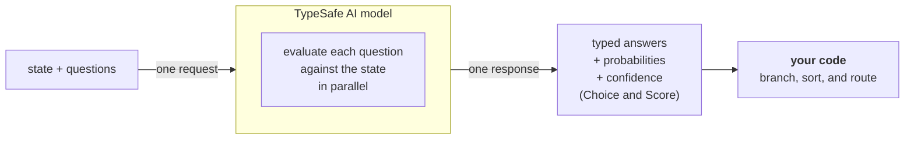

# 1. Introduction & concepts

[← Back to README](../README.md) · Source: <https://docs.typesafe.ai/introduction>

## What is TypeSafe?

Large language models are built to produce text for people to read. If you need a model to make a judgment that **your code** will consume, you end up forcing a text generator to emit structured decisions, then parsing them back into something your code can rely on.

**Jev** is TypeSafe's flagship model and the first **System One** model. It evaluates typed *questions* against a *state* and returns structured results directly. It doesn't generate or parse text. You get typed values and probability distributions you can branch on, sort by, and route with.



## System One

The name comes from Daniel Kahneman's *Thinking, Fast and Slow*. **System 1** thinking is fast and intuitive. **System 2** is slow and deliberate. System One models are built for fast, focused judgments.

| Primitive | Example question | Answer space | Example output |
|---|---|---|---|
| Choice | Which team should handle this ticket? | `billing`, `technical`, `account` | `choice: "billing"` |
| Score | How frustrated is this customer? | 0 = calm, 1 = frustrated, 2 = very frustrated | `score: 1.4` |
| Noul | Does this message request a refund? | true / false | `noul: 0.95` |

### How it differs from an LLM

- It's trained for **calibrated decisions**: its probabilities are optimized against real outcomes to reflect uncertainty. Calibration holds across groups of predictions. It doesn't promise that any single answer is correct.
- It **doesn't** write replies, produce code, or explain its reasoning.
- Every output is **constrained to the options you supply**, so it never invents a value outside your schema.
- Most queries finish in **about 100 ms**, which is fast enough for real-time request paths and UIs.
- Input is **text only** for now: strings, JSON objects, or arrays of text. Images, audio, and video aren't supported yet.

### Fast judgments inside a larger workflow

For a refund request, your application might:

1. Build a state that holds the customer's message, the relevant transactions, and the refund policy.
2. Ask independent questions together: was a refund requested, does the evidence show a duplicate charge, does the policy support a refund?
3. Combine the answers with deterministic checks in code, then act on the case or route it for review.

## Atomic questions, composed in code

> Think of each question as a gut-check: the kind of judgment a highly knowledgeable person could make in a few seconds given the right context.

If a question needs extended reasoning or weighs several independent factors, **decompose it**. Ask each factor as its own question, then combine the results in code.

**Python**

```python
# ❌ One broad question
"Rate this startup pitch"

# ✅ Atomic questions, combined in code
market   = answers["market_size"].score / 4
tech     = answers["technical_feasibility"].score / 4
moat     = answers["differentiation"].score / 4
priority = 0.5 * market + 0.3 * tech + 0.2 * moat   # change weights, not prompts
```

**TypeScript**

<!-- ts-check run:
declare const pitch: string;
-->
```ts
import { score, TypeSafeClient } from "@typesafe-ai/sdk";

// ❌ One broad question:  score("Rate this startup pitch", [...])

// ✅ Atomic questions, combined in code
const { answers } = await new TypeSafeClient().systemOne({
  state: pitch,
  questions: {
    market_size: score("How large is the market the pitch targets?", [
      "No market described", "Niche", "Mid-sized", "Large", "Very large, well evidenced",
    ]),
    technical_feasibility: score("How feasible is the technology described?", [
      "Not feasible", "Unproven", "Plausible", "Demonstrated", "Already shipping",
    ]),
    differentiation: score("How differentiated is the product from existing alternatives?", [
      "Identical to alternatives", "Slightly different", "Clearly different", "Hard to copy", "Unique moat",
    ]),
  },
});

const market = answers.market_size.score / 4;
const tech = answers.technical_feasibility.score / 4;
const moat = answers.differentiation.score / 4;
const priority = 0.5 * market + 0.3 * tech + 0.2 * moat; // change weights, not prompts
```

## Three software architectures

| Architecture | Description |
|---|---|
| **Traditional software** | A complex decision tree built from simple, reliable primitives. |
| **LLM agents** | An agent reads instructions and picks its next step. This works when a person is watching, but every loop is another chance to go off the rails. |
| **AI-powered software** (TypeSafe) | Code owns the control flow. The model shows up only where you need programmable common sense or need to interpret unstructured data. Every AI task stays atomic and constrained. |

## Jev and coding agents

Source: <https://docs.typesafe.ai/introduction/coding-agents>

Jev is **not** a drop-in replacement for the LLM behind Claude Code, Cursor, Copilot, and similar tools. No `model: "jev-latest"` setting turns a coding agent into a Jev-powered one. What you can do is use your coding agent as usual to write code that **calls** Jev.

| You wanted to… | Do this |
|---|---|
| Make your coding agent better at writing TypeSafe code | Install the [agent skill](13-agent-skill.md) |
| Use Jev for routing, classification, scoring, or guardrails inside your app | Start with the [Quick start](02-quickstart.md), then read [How to build](06-building-with-typesafe.md) and [Patterns](07-patterns.md) |
| Replace the model that powers a coding agent | Jev isn't the tool for this |
| Try Jev before writing code | Use the [Playground](https://console.typesafe.ai/playground) |

**When Jev is worth reaching for:**

- Routing a request to one of a fixed set of destinations, and knowing how confident that routing is.
- Scoring something on a rubric (urgency, quality, risk) and branching on the number.
- Checking whether a statement holds for a document, message, or record before acting.
- Replacing a fragile "return JSON" prompt with a call that returns typed values by construction.

## AI primer: why RLCD

Source: <https://docs.typesafe.ai/introduction/machine-learning-primer>

TypeSafe's bet is that large-scale automation will be mostly **AI-to-AI and AI-to-software** traffic (about 99% machine-to-machine), so the machine interface matters more than the chat interface. They call this **Machine Native Intelligence**: AI with software-like properties such as structure, reliability, observability, testability, speed, consistency, and low cost.

| Post-training approach | What it produced |
|---|---|
| **RLHF**: reinforcement learning from human feedback | Chatbots that give answers people prefer. This can reward sycophancy and confident hallucinations, and causes *mode dropping*. |
| **RLVR**: reinforcement learning with verifiable rewards | Reasoning models that are strong at math, but slower and more expensive |
| **RLCD**: reinforcement learning for calibrated decisions | TypeSafe's models, which return decisions and calibrated probabilities instead of text |

What calibration means in practice, across many predictions:

- Outcomes given probability `0.2` happen about 20% of the time.
- Outcomes given probability `0.8` happen about 80% of the time.
- Outcomes given probability `1.0` always happen.

## Example use-case categories

Source: <https://docs.typesafe.ai/concepts/use-case-map>

- **AI automation software:** run AI a million times in the background with no human co-pilot.
- **Real-time applications:** decisions in about 150 ms, fast enough for games or inline UI.
- **AI map-reduce over big data:** costs are roughly 100× lower, so you can classify, search, and extract features over huge corpora.
- **Universal verification:** check prompts, extractions, reasoning traces, and tool calls for jailbreaks, citation errors, and hallucinations.
- **Harness engineering:** model routing, semantic context retrieval, LLM guardrails, and trace classification.

---

Next: [2. Quick start →](02-quickstart.md)
