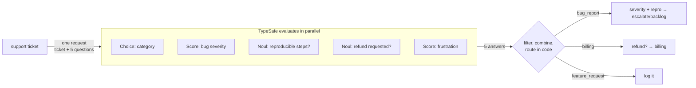
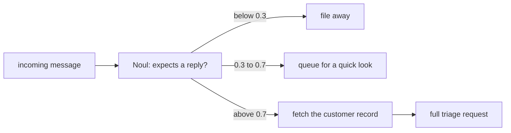
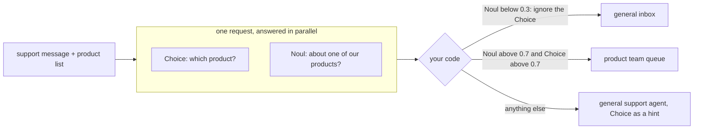
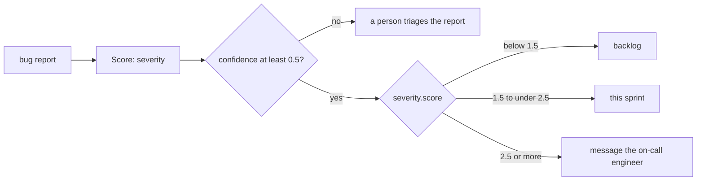
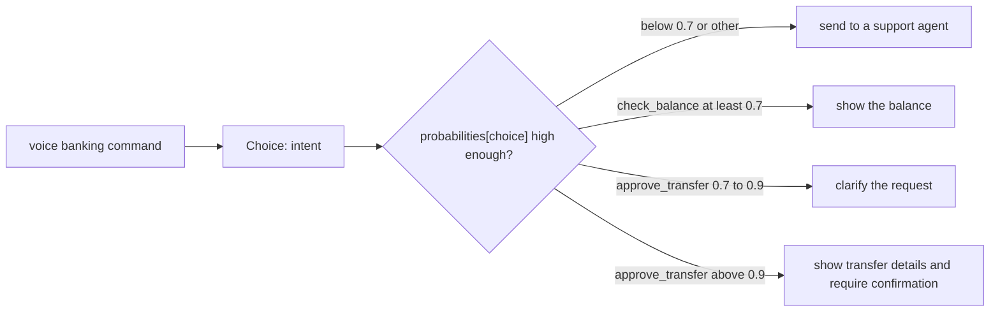
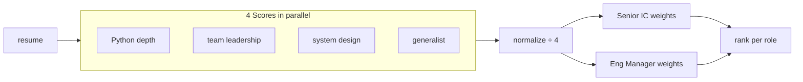
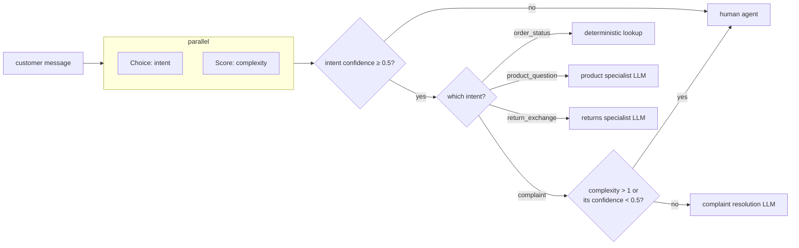

# 7. Patterns

[← Back to README](../README.md) · Source: <https://docs.typesafe.ai/patterns>

TypeSafe sits inside a larger system and powers its decisions. This page assumes you know the [primitives](04-primitives/README.md) and [how confidence works](05-confidence.md). The key skill is thinking in **discrete, atomic decisions** that add up to complex system behavior.

| Pattern | What it does | Benefits |
|---|---|---|
| [Speculative fan-out](#speculative-fan-out) | Sends many questions in one request, including speculative ones, and lets code pick what's relevant | Cost, speed |
| [Screen with a Noul first](#screen-with-a-noul-first) | Asks one cheap yes/no question first, and runs the expensive stage only when it passes | Cost, speed |
| [Companion Noul](#companion-noul) | Pairs a Choice with a Noul that asks whether anything fits, so code can tell when nothing does | Reliability |
| [Routing by confidence](#routing-by-confidence) | Sends a Score answer to a person when its confidence is low, and routes the rest on the score | Reliability, safety |
| [Routing by probability](#routing-by-probability) | Sets a higher probability threshold for riskier actions | Reliability, safety |
| [Composite scoring](#composite-scoring) | Combines several dimensions into one score with weights in code | Cost, reliability, speed |

[Intent routing](#intent-routing) is kept at the end as an archived example: its official page was removed and now redirects to Routing by probability.

## Patterns by goal

Every pattern splits a decision into small System One questions and leaves the decision to your code: Jev answers each question with a probability, and your code decides what happens next.

- **Spend less.** [Speculative fan-out](#speculative-fan-out) asks everything in one request. [Screen with a Noul first](#screen-with-a-noul-first) keeps expensive stages from running on inputs that don't need them.
- **Act safely.** [Routing by probability](#routing-by-probability) sets a higher threshold for riskier actions. [Routing by confidence](#routing-by-confidence) sends a Score answer that's spread across the scale to a person. [Companion Noul](#companion-noul) catches the case where nothing fits.
- **Combine answers.** [Composite scoring](#composite-scoring) adds up several Scores with weights you control.

---

## Speculative fan-out

Source: <https://docs.typesafe.ai/patterns/fan-out>

Put **every** question your system might need into one request, and decide in code which answers matter. Speculative questions cost almost nothing when they turn out to be irrelevant, and they save a round trip when they're not.



### Step 1: fan out

```json
{
  "state": "Hi, I placed an order (#98423) last Thursday and was charged twice. I also can't log in after the site update, and adding Apple Pay would be really helpful. This is getting frustrating.",
  "model": "jev-latest",
  "questions": {
    "category": {
      "type": "choice",
      "instructions": "Determine the broad category of this support ticket",
      "criteria": {
        "bug_report": "The user is reporting something that is broken or producing errors",
        "billing": "Charges, invoices, refunds, subscriptions",
        "feature_request": "The user is requesting new functionality",
        "account": "Login, permissions, profile, security"
      }
    },
    "bug_severity": {
      "type": "score",
      "instructions": "How severe is the reported issue",
      "criteria": [
        "Cosmetic; no impact to functionality",
        "Broken or degraded feature; workaround exists",
        "Blocking issue; no workaround exists"
      ]
    },
    "has_reproducible_steps": {
      "type": "noul",
      "instructions": "The user describes specific steps to reproduce the issue"
    },
    "refund_requested": {
      "type": "noul",
      "instructions": "The user is explicitly asking for a refund or credit"
    },
    "frustration": {
      "type": "score",
      "instructions": "How frustrated the user appears",
      "criteria": ["Calm, matter-of-fact", "Frustrated but civil", "Very angry"]
    }
  }
}
```

> `bug_severity` and `has_reproducible_steps` only matter for bug reports, and `refund_requested` only matters for billing. Ask them all up front anyway.

### Step 2: route with code

**Python**

```python
category = response.answers["category"]
bug_severity = response.answers["bug_severity"]
bug_repro = response.answers["has_reproducible_steps"]
refund = response.answers["refund_requested"]
frustration = response.answers["frustration"]

if category.choice == "bug_report":
    if bug_severity.score > 1.5 and bug_repro.noul > 0.6:
        escalate_to_engineering(ticket_id, severity="high")
    else:
        add_to_bug_backlog(ticket_id)

elif category.choice == "billing":
    if refund.noul > 0.7:
        route_to_billing_with_flag(ticket_id, refund_likely=True)
    else:
        route_to_billing(ticket_id)

elif category.choice == "feature_request":
    log_feature_request(ticket_id)

# Frustration is useful regardless of category
if frustration.score > 1.5:
    flag_for_priority_response(ticket_id)
```

**TypeScript**

<!-- ts-check run:
declare const ticket: string;
declare const ticketId: string;
declare function escalateToEngineering(id: string, severity: "high"): void;
declare function addToBugBacklog(id: string): void;
declare function routeToBillingWithFlag(id: string, o: { refundLikely: boolean }): void;
declare function routeToBilling(id: string): void;
declare function logFeatureRequest(id: string): void;
declare function flagForPriorityResponse(id: string): void;
-->
```ts
import { choice, noul, score, TypeSafeClient } from "@typesafe-ai/sdk";

const { answers } = await new TypeSafeClient().systemOne({
  state: ticket,
  questions: {
    category: choice("Determine the broad category of this support ticket", {
      bug_report: "The user is reporting something that is broken or producing errors",
      billing: "Charges, invoices, refunds, subscriptions",
      feature_request: "The user is requesting new functionality",
      account: "Login, permissions, profile, security",
    }),
    bug_severity: score("How severe is the reported issue", [
      "Cosmetic; no impact to functionality",
      "Broken or degraded feature; workaround exists",
      "Blocking issue; no workaround exists",
    ]),
    has_reproducible_steps: noul("The user describes specific steps to reproduce the issue"),
    refund_requested: noul("The user is explicitly asking for a refund or credit"),
    frustration: score("How frustrated the user appears", ["Calm, matter-of-fact", "Frustrated but civil", "Very angry"]),
  },
});

const { category, bug_severity, has_reproducible_steps, refund_requested, frustration } = answers;

if (category.choice === "bug_report") {
  if (bug_severity.score > 1.5 && has_reproducible_steps.noul > 0.6) escalateToEngineering(ticketId, "high");
  else addToBugBacklog(ticketId);
} else if (category.choice === "billing") {
  if (refund_requested.noul > 0.7) routeToBillingWithFlag(ticketId, { refundLikely: true });
  else routeToBilling(ticketId);
} else if (category.choice === "feature_request") {
  logFeatureRequest(ticketId);
}

// Frustration is useful regardless of category
if (frustration.score > 1.5) flagForPriorityResponse(ticketId);
```

### Anti-pattern: sequential calls

**Python**

```python
# ❌ Slower and more expensive: three round trips
cat = ask("What category of request is this?")
if cat == "smarthome_command":
    device = ask("What type of device is this request targeting?")
    if device == "lights":
        action = ask("What action should be taken on the lights?")

# ✅ One round trip: ask everything, including speculative questions
answers = client.system_one(state=req, questions={
    "category": ..., "domain": ..., "device": ..., "light_action": ..., "thermostat_action": ...,
}).answers
```

**TypeScript**

<!-- ts-check:
import { choice, TypeSafeClient } from "@typesafe-ai/sdk";
declare const client: TypeSafeClient;
declare const req: string;
declare function ask(q: string): Promise<string>;
const category = choice("What category of request is this?", { smarthome_command: null, conversation: null });
const domain = choice("What domain is this request targeting?", { whole_house: null, single_room: null });
const device = choice("What type of device is this request targeting?", { lights: null, thermostat: null });
const light_action = choice("What action should be taken on the lights?", { on: null, off: null });
const thermostat_action = choice("What should the thermostat do?", { warmer: null, cooler: null });
-->
```ts
// ❌ Slower and more expensive: three sequential round trips
const cat = await ask("What category of request is this?");
if (cat === "smarthome_command") {
  const device = await ask("What type of device is this request targeting?");
  if (device === "lights") {
    const action = await ask("What action should be taken on the lights?");
  }
}

// ✅ One round trip: ask everything, including speculative questions
const { answers } = await client.systemOne({
  state: req,
  questions: { category, domain, device, light_action, thermostat_action },
});
```

---

## Screen with a Noul first

Source: <https://docs.typesafe.ai/patterns/noul-screen>

Not every input needs your expensive step. Ask **one Noul** first, over a small state such as the input on its own, and run the expensive step only on a clear yes. A clear no gets cheaper handling, and an answer the Noul can't settle gets an outcome of its own, so every input is handled.



**When to screen first, and when to fan out instead.** Jev reads the state once and answers every question in parallel, so if the later questions use the **same** state, [fan out](#speculative-fan-out): ask them all in one request. Screening first earns its extra request only when the next step costs something the first question doesn't:

- **A bigger state:** the next step needs a customer record, a full thread, or an attachment that code has to fetch.
- **A slower model:** the next step is an LLM call.
- **A person:** the next step needs someone to look at the item.

### Example: triaging a shared inbox

The screening question sees only the message. Its `false` criterion lists the kinds of message with nothing to answer, rather than just saying "not waiting":

```json
{
  "state": {
    "message": {
      "from": "Tom Reilly <tom.reilly@example.com>",
      "subject": "Re: Order 47710 delivered",
      "body": "Just so you know, the desk arrived with one of the cross-bar screws missing. I had a spare so it's built now. Might be worth checking the packing on that line."
    }
  },
  "model": "jev-latest",
  "questions": {
    "expects_reply": {
      "type": "noul",
      "instructions": "The sender of `message` is waiting for a reply",
      "criteria": {
        "true": "The message asks us something or raises something that needs an answer",
        "false": "Nothing to answer: an automated notification, receipt, newsletter, or marketing email, or a note from a person that needs no reply"
      }
    }
  }
}
```

Tom's note reports a problem but asks for nothing, so the answer is unsettled: `"expects_reply": { "type": "noul", "noul": 0.44 }`. Recorded `jev-1.14.0` answers for five messages:

| Message | `expects_reply` | Outcome |
|---|---|---|
| "I ordered a standing desk two weeks ago and the tracking hasn't updated... I'm moving on the 30th" | 0.98 | triage |
| "Just so you know, the desk arrived with one of the cross-bar screws missing..." | 0.44 | quick look |
| "Thanks, the desk arrived yesterday and it's great." | 0.10 | file away |
| "20% off every desk and chair until Sunday. Unsubscribe" | 0.02 | file away |
| "Your payment of $129.00 was successful... replies to this address are not monitored." | 0.02 | file away |

Above 0.7 is a yes and below 0.3 a no; both are good starting points. Give the band in between its own outcome instead of rounding it.

**Python**

```python
from typesafe_sdk import Noul, NoulCriteria, TypeSafeClient

client = TypeSafeClient()
YES_ABOVE = 0.7
NO_BELOW = 0.3
SCREEN = {
    "expects_reply": Noul(
        instructions="The sender of `message` is waiting for a reply",
        criteria=NoulCriteria(
            true="The message asks us something or raises something that needs an answer",
            false="Nothing to answer: an automated notification, receipt, newsletter, or marketing email, or a note from a person that needs no reply",
        ),
    )
}


def handle(message_id: str, message: dict) -> None:
    expects_reply = client.system_one({"message": message}, SCREEN).nouls["expects_reply"].noul

    if expects_reply < NO_BELOW:
        # Newsletters, receipts, notifications. Nothing to answer.
        file_away(message_id)
    elif expects_reply > YES_ABOVE:
        # A person is waiting. Fetch what triage needs and run the full request.
        customer = fetch_customer(message_id)
        triage(message_id, customer)
    else:
        # Something to look at, but maybe nothing to answer. One glance settles it.
        queue_for_quick_look(message_id)
```

**TypeScript**

<!-- ts-check run:
declare function fileAway(id: string): void;
declare function fetchCustomer(id: string): Promise<{ [key: string]: string }>;
declare function triage(id: string, customer: { [key: string]: string }): Promise<void>;
declare function queueForQuickLook(id: string): void;
-->
```ts
import { noul, TypeSafeClient } from "@typesafe-ai/sdk";

const client = new TypeSafeClient();
const YES_ABOVE = 0.7;
const NO_BELOW = 0.3;
const SCREEN = {
  expects_reply: noul("The sender of `message` is waiting for a reply", {
    true: "The message asks us something or raises something that needs an answer",
    false:
      "Nothing to answer: an automated notification, receipt, newsletter, or marketing email, or a note from a person that needs no reply",
  }),
};

async function handle(messageId: string, message: { from: string; subject: string; body: string }) {
  const { answers } = await client.systemOne({ state: { message }, questions: SCREEN });
  const expectsReply = answers.expects_reply.noul;

  if (expectsReply < NO_BELOW) fileAway(messageId); // nothing to answer
  else if (expectsReply > YES_ABOVE) await triage(messageId, await fetchCustomer(messageId)); // a person is waiting
  else queueForQuickLook(messageId); // one glance settles it
}

await handle("m-47710", {
  from: "Tom Reilly <tom.reilly@example.com>",
  subject: "Re: Order 47710 delivered",
  body: "Just so you know, the desk arrived with one of the cross-bar screws missing. I had a spare so it's built now.",
});
```

Only messages with a clear yes get the full triage request, which adds the customer record to the state and asks one-thing questions: a `request` Choice (order status, return or refund, product question, complaint), an `urgency` Score counted from `message.received`, and a `repeat_contact` Noul over `customer.previous_contacts`. For the late standing desk that returned `order_status` at 1.0, urgency 1.99 (confidence 0.98), and `repeat_contact` 0.99; with no previous contacts on file, the same message got 0.05.

**Other ways to screen:** run a cheap step, then ask a Noul whether its output is right and send only failures to the expensive model (see the [SDE cascade](08-cookbooks.md#sde-cascade)); or chain screens, such as "written in English" before "about our product".

---

## Companion Noul

Source: <https://docs.typesafe.ai/patterns/companion-noul>

A Choice always picks an option, even when none applies, and sometimes with a high probability: it answers the question it was asked by picking the closest option. Add a **Noul to the same request** that asks whether any option fits, and use the Choice only when that Noul is a clear yes.



### Example: routing messages to product teams

You sell three products and route each support message to that product's team. Messages about anything else go to a general inbox. Both questions point at the product list by its key, `products`:

```json
{
  "state": {
    "products": {
      "desk_pro": "Desk Pro: an electric sit-stand desk with a 140 cm top",
      "chair_lite": "Chair Lite: a mesh-back office chair with adjustable arms",
      "monitor_arm": "Monitor Arm: a clamp-on arm that holds one monitor up to 32 inches"
    },
    "message": "My desk lamp stopped working after two weeks. The bulb is fine, it just won't switch on. Can I get a replacement?"
  },
  "model": "jev-latest",
  "questions": {
    "product": {
      "type": "choice",
      "instructions": "Which product in `products` is `message` about?",
      "criteria": {
        "desk_pro": "Desk Pro: an electric sit-stand desk with a 140 cm top",
        "chair_lite": "Chair Lite: a mesh-back office chair with adjustable arms",
        "monitor_arm": "Monitor Arm: a clamp-on arm that holds one monitor up to 32 inches"
      }
    },
    "about_our_product": {
      "type": "noul",
      "instructions": "`message` is about one of the products in `products`",
      "criteria": {
        "true": "The sender mentions, asks about, or has a problem with one of those products",
        "false": "The message is about something else: another product, a service, or nothing we sell"
      }
    }
  }
}
```

The Choice picks `desk_pro` at 0.96 (confidence 0.94): of the three, a desk lamp is closest to a desk. Nothing in that answer says the message isn't about your desk. The companion Noul reads **0.02**. Recorded `jev-1.14.0` answers:

| Message | Choice | Top probability | Noul |
|---|---|---|---|
| "The motor on my standing desk has started making a grinding noise... the 140 cm one" | `desk_pro` | 1.00 | 0.98 |
| "The chair arrived but the monitor arm didn't. Can you check where the arm is?" | `monitor_arm` | 1.00 | 0.99 |
| "My desk lamp stopped working after two weeks..." | `desk_pro` | 0.96 | 0.02 |
| "I'm a recruiter working with several furniture retailers..." | `desk_pro` | 0.81 | 0.02 |

Read the Noul first. A clear no means the Choice is noise. A clear yes says the message is about one of your products but not which one, so also check the probability of the product the Choice picked.

**Python**

```python
from typesafe_sdk import SystemOneResponse

YES = 0.7
NO = 0.3
PRODUCT_SURE = 0.7


def route(message_id: str, response: SystemOneResponse) -> None:
    about_ours = response.nouls["about_our_product"].noul
    product = response.choices["product"]
    product_probability = product.probabilities[product.choice]

    if about_ours < NO:
        # Nothing fits. The Choice's answer is noise; don't read it.
        send_to_general_inbox(message_id)
    elif about_ours > YES and product_probability > PRODUCT_SURE:
        # The Choice is answering a question that applies, and it clearly picked one product. Use it.
        send_to_product_team(message_id, product.choice)
    else:
        # Unsettled, or about our products but not clearly which one:
        # a person decides, with the Choice's top option as a hint.
        send_to_general_agent(message_id, suggested_product=product.choice)
```

**TypeScript**

<!-- ts-check run:
declare function sendToGeneralInbox(id: string): void;
declare function sendToProductTeam(id: string, product: string): void;
declare function sendToGeneralAgent(id: string, suggestedProduct: string): void;
-->
```ts
import { choice, noul, TypeSafeClient } from "@typesafe-ai/sdk";

const client = new TypeSafeClient();
const YES = 0.7;
const NO = 0.3;
const PRODUCT_SURE = 0.7;

const PRODUCTS = {
  desk_pro: "Desk Pro: an electric sit-stand desk with a 140 cm top",
  chair_lite: "Chair Lite: a mesh-back office chair with adjustable arms",
  monitor_arm: "Monitor Arm: a clamp-on arm that holds one monitor up to 32 inches",
};
const QUESTIONS = {
  product: choice("Which product in `products` is `message` about?", PRODUCTS),
  about_our_product: noul("`message` is about one of the products in `products`", {
    true: "The sender mentions, asks about, or has a problem with one of those products",
    false: "The message is about something else: another product, a service, or nothing we sell",
  }),
};

async function route(messageId: string, message: string) {
  const { answers } = await client.systemOne({ state: { products: PRODUCTS, message }, questions: QUESTIONS });
  const aboutOurs = answers.about_our_product.noul;
  const product = answers.product;
  const productProbability = product.probabilities[product.choice];

  if (aboutOurs < NO) sendToGeneralInbox(messageId); // nothing fits: the Choice is noise
  else if (aboutOurs > YES && productProbability > PRODUCT_SURE) sendToProductTeam(messageId, product.choice);
  else sendToGeneralAgent(messageId, product.choice); // unsettled: a person decides, with a hint
}

await route("m-1", "My desk lamp stopped working after two weeks. Can I get a replacement?");
```

### Why not an `other` option?

`other: "Something else"` looks like less work, and it used to be the usual advice. But `other` competes with the real options for probability: a message partly about a product and partly about something else splits its probability between `other` and that product, and neither number tells your code what to do. With a companion Noul, the Choice picks only among the real options and a separate question, with concrete `true` and `false` criteria, decides whether any fits. In TypeSafe's tests that usually works better.

A [Box](04-primitives/box.md) has the same problem: it always returns a location. Pair it with a Noul such as "Is there a coffee mug in `photo`?".

**Other ways to use a companion Noul:**

- **One Noul per option.** When a message can be about several products, ask one Noul per product and read each on its own. The nothing-fits case needs no extra question: every Noul comes back low.
- **As a screen.** Ask the Noul first and run the Choice or Score only on a clear yes. See [Screen with a Noul first](#screen-with-a-noul-first).
- **Candidates from code.** Build the options from values found in the text, and let the companion Noul ask whether the right value is among them. ([Pre-parsed value extraction](08-cookbooks.md#pre-parsed-value-extraction) builds candidates this way, but with a `none` option.)

---

## Routing by confidence

Source: <https://docs.typesafe.ai/patterns/confidence-routing>

A Score answer gives a position on the scale, `score`, and a `confidence` that says how settled it is. **Check the confidence first**: send an answer whose probability is spread across the scale to a person, and route the rest on the score. The score tells you *what*; confidence tells you *whether to act on it*.



### Example: triaging bug reports

```json
{
  "state": {
    "report": {
      "title": "Notes gone?",
      "body": "Some of my notes aren't there after the update. Not sure if I deleted them myself a while ago. Also the sync icon looks a bit different now."
    }
  },
  "model": "jev-latest",
  "questions": {
    "severity": {
      "type": "score",
      "instructions": "How severe is the problem described in `report`?",
      "criteria": [
        "Cosmetic: wording, layout, or styling only",
        "Minor: something misbehaves, but users can still do what they wanted",
        "Major with a workaround: a feature is broken, but there is another way to get the job done",
        "Major with no workaround: users cannot complete a core task",
        "Critical: data loss, a security hole, or the product is down for everyone"
      ]
    }
  }
}
```

Jev answers `score` 3.19 with `confidence` **0.34**: probabilities 0.01 / 0.14 / 0.07 / 0.19 / 0.59 across the five levels. A score of 3.19 alone would page the on-call engineer, but 0.14 sits on "minor" (maybe the user deleted the notes), and that spread pulls confidence down. Recorded `jev-1.14.0` answers:

| Report | `score` | `confidence` | Outcome |
|---|---|---|---|
| Typo on the settings page | 0.0 | 1.0 | backlog |
| PDF export fails over 50 pages; splitting the document works | 2.0 | 1.0 | this sprint |
| Checkout returns a 500 error for every customer | 3.36 | 0.7 | message on-call |
| Notes gone after the update, or maybe deleted | 3.19 | 0.34 | triage |

**Python**

```python
from typesafe_sdk import Score, TypeSafeClient

client = TypeSafeClient()
SEVERITY = Score(
    instructions="How severe is the problem described in `report`?",
    criteria=[
        "Cosmetic: wording, layout, or styling only",
        "Minor: something misbehaves, but users can still do what they wanted",
        "Major with a workaround: a feature is broken, but there is another way to get the job done",
        "Major with no workaround: users cannot complete a core task",
        "Critical: data loss, a security hole, or the product is down for everyone",
    ],
)


def route_report(report_id: str, report: dict) -> None:
    severity = client.system_one({"report": report}, {"severity": SEVERITY}).scores["severity"]

    if severity.confidence < 0.5:
        # The probability is spread across the scale. A person reads the report first.
        send_to_triage(report_id)
    elif severity.score < 1.5:
        add_to_backlog(report_id)
    elif severity.score < 2.5:
        add_to_sprint(report_id)
    else:
        message_on_call(report_id)
```

**TypeScript**

<!-- ts-check run:
declare function sendToTriage(id: string): void;
declare function addToBacklog(id: string): void;
declare function addToSprint(id: string): void;
declare function messageOnCall(id: string): void;
-->
```ts
import { score, TypeSafeClient } from "@typesafe-ai/sdk";

const client = new TypeSafeClient();
const SEVERITY = score("How severe is the problem described in `report`?", [
  "Cosmetic: wording, layout, or styling only",
  "Minor: something misbehaves, but users can still do what they wanted",
  "Major with a workaround: a feature is broken, but there is another way to get the job done",
  "Major with no workaround: users cannot complete a core task",
  "Critical: data loss, a security hole, or the product is down for everyone",
]);

async function routeReport(reportId: string, report: { title: string; body: string }) {
  const { answers } = await client.systemOne({ state: { report }, questions: { severity: SEVERITY } });
  const severity = answers.severity;

  if (severity.confidence < 0.5) sendToTriage(reportId); // spread across the scale: a person reads it first
  else if (severity.score < 1.5) addToBacklog(reportId);
  else if (severity.score < 2.5) addToSprint(reportId);
  else messageOnCall(reportId);
}

await routeReport("BUG-112", { title: "Notes gone?", body: "Some of my notes aren't there after the update." });
```

### When two levels split the answer

A Score's confidence counts probability on a **neighboring** level as only a small spread. That's a problem when your threshold sits between those two levels: an answer split between them can pass the confidence check and land on the wrong side. When the decision depends on which side of a boundary the answer falls, add up the probabilities on the side that matters:

**Python**

```python
blocked = severity.probabilities[3] + severity.probabilities[4]  # "no workaround" or worse

if blocked >= 0.3:
    # A real chance users are blocked. Message someone rather than wait for the sprint.
    message_on_call(report_id)
```

**TypeScript**

<!-- ts-check:
import type { ScoreResponse } from "@typesafe-ai/sdk";
declare const severity: ScoreResponse;
declare const reportId: string;
declare function messageOnCall(id: string): void;
-->
```ts
const blocked = (severity.probabilities[3] ?? 0) + (severity.probabilities[4] ?? 0); // "no workaround" or worse

if (blocked >= 0.3) messageOnCall(reportId); // a real chance users are blocked
```

---

## Routing by probability

Source: <https://docs.typesafe.ai/patterns/probability-routing>

The answer says *what to do*; its **probability** says *whether to do it*. For each action your code can take, decide how high the probability must be, give riskier actions higher thresholds, and give an answer below the threshold its own outcome, such as asking the user to clarify. Example: a voice banking interface.



### Step 1: ask what the user wants to do

```json
{
  "state": "What's my balance?",
  "model": "jev-latest",
  "questions": {
    "intent": {
      "type": "choice",
      "instructions": "What action is the user requesting?",
      "criteria": {
        "check_balance": "Check the balance of an account",
        "approve_transfer": "Approve the pending transfer request",
        "other": "Something else"
      }
    }
  }
}
```

Jev answers `check_balance` at 1.0. The `other` option keeps the example short; a [companion Noul](#companion-noul) usually works better as a catch-all.

### Step 2: set a threshold for each action

Compare `probabilities[choice]`, how likely it is that this option is what the user asked for, against the action's threshold.

**Python**

```python
action = response.choices["intent"]
likelihood = action.probabilities[action.choice]

# Below 0.7 on any action, the command didn't settle the intent. Route to a human.
if likelihood < 0.7:
    route_to_support_agent(account_id)

elif action.choice == "check_balance":
    # Low stakes. 0.7 is sufficient.
    show_balance(account_id)

elif action.choice == "approve_transfer":
    if likelihood > 0.9:
        # Identifying the intent starts confirmation; it does not approve a transfer.
        show_transfer_for_confirmation(account_id)
    else:
        # Clarify what the user wants before opening the transfer workflow.
        ask_user_to_clarify("Would you like to review the pending transfer?")

else:
    route_to_support_agent(account_id)
```

**TypeScript**

<!-- ts-check run:
const command = "What's my balance?";
const accountId = "acct-1";
declare function routeToSupportAgent(a: string): void;
declare function showBalance(a: string): void;
declare function showTransferForConfirmation(a: string): void;
declare function askUserToClarify(q: string): void;
-->
```ts
import { choice, TypeSafeClient } from "@typesafe-ai/sdk";

const client = new TypeSafeClient();
const { answers } = await client.systemOne({
  state: command,
  questions: {
    intent: choice("What action is the user requesting?", {
      check_balance: "Check the balance of an account",
      approve_transfer: "Approve the pending transfer request",
      other: "Something else",
    }),
  },
});
const action = answers.intent;
const likelihood = action.probabilities[action.choice];

if (likelihood < 0.7) {
  routeToSupportAgent(accountId); // the command didn't settle the intent
} else if (action.choice === "check_balance") {
  showBalance(accountId); // low stakes: 0.7 is enough
} else if (action.choice === "approve_transfer") {
  // Identifying the intent starts confirmation; it never approves a transfer.
  if (likelihood > 0.9) showTransferForConfirmation(accountId);
  else askUserToClarify("Would you like to review the pending transfer?");
} else {
  routeToSupportAgent(accountId);
}
```

**No threshold moves money.** The thresholds only choose which workflow runs: a clear transfer request opens a confirmation screen with the amount and recipient, and the transfer runs only after the user confirms. A hesitant command can still have a clear intent: "Um, the transfer thing... yeah, go ahead I guess." got 0.99 for `approve_transfer` on `jev-1.14.0`. That says which action the user wants, not that they've checked the details.

> **Why not `confidence`?** For a Choice with a fixed number of options, `confidence` is computed from the top probability, so a threshold on it adds nothing, and the probability is easier to read as risk. If it matters how the other options compare, check their probabilities too. Confidence earns its keep on a Score: see [Routing by confidence](#routing-by-confidence) and [Confidence](05-confidence.md).

---

## Composite scoring

Source: <https://docs.typesafe.ai/patterns/composite-scoring>

Break a complex judgment into independent dimensions, score each one, and combine them with weights **you** control. Example: screening resumes for two different roles.



### Step 1: score each dimension independently

```json
{
  "questions": {
    "python_depth": {
      "type": "score",
      "instructions": "How much depth of python experience does this candidate have, based on the supplied resume?",
      "criteria": [
        "No Python experience mentioned",
        "Mentioned but no detail",
        "Used in projects, some specifics",
        "Primary language, multiple projects",
        "Deep expertise: architecture, performance, libraries"
      ]
    },
    "team_leadership": {
      "type": "score",
      "instructions": "How much experience does this candidate have managing or leading engineering teams?",
      "criteria": [
        "No management experience mentioned",
        "Informal mentorship or tech lead role",
        "Led a small team or project",
        "Managed a team with direct reports",
        "Managed multiple teams or an engineering org"
      ]
    },
    "system_design": {
      "type": "score",
      "instructions": "How much experience does this candidate have designing large-scale or distributed systems?",
      "criteria": [
        "No architecture work mentioned",
        "Contributed to design discussions",
        "Designed components of a larger system",
        "Owned architecture of a significant system",
        "Designed systems at scale across multiple domains"
      ]
    },
    "generalist": {
      "type": "score",
      "instructions": "How much evidence is there that this candidate picks up unfamiliar tools, roles, or domains outside their core specialty?",
      "criteria": [
        "Only one domain or role mentioned",
        "Some variety but within a narrow field",
        "Worked across a few different areas or tech stacks",
        "Regularly moved between domains, wore many hats",
        "Track record of ramping up in unfamiliar areas and delivering"
      ]
    }
  }
}
```

### Step 2: combine with weights

**Python**

```python
py      = response.answers["python_depth"].score / 4
lead    = response.answers["team_leadership"].score / 4
arch    = response.answers["system_design"].score / 4
general = response.answers["generalist"].score / 4

# Senior IC
ic_score = (0.40 * py) + (0.10 * lead) + (0.40 * arch) + (0.10 * general)

# Engineering Manager
em_score = (0.15 * py) + (0.40 * lead) + (0.20 * arch) + (0.25 * general)
```

**TypeScript**

<!-- ts-check:
import type { ScoreResponse } from "@typesafe-ai/sdk";
declare const answers: Record<"python_depth" | "team_leadership" | "system_design" | "generalist", ScoreResponse>;
-->
```ts
const py = answers.python_depth.score / 4;
const lead = answers.team_leadership.score / 4;
const arch = answers.system_design.score / 4;
const general = answers.generalist.score / 4;

// Senior IC
const icScore = 0.4 * py + 0.1 * lead + 0.4 * arch + 0.1 * general;

// Engineering Manager
const emScore = 0.15 * py + 0.4 * lead + 0.2 * arch + 0.25 * general;
```

Rank candidates over a batch:

**Python**

```python
from concurrent.futures import ThreadPoolExecutor

def evaluate(resume: str) -> dict:
    a = client.system_one(state=resume, questions=RESUME_QUESTIONS).answers
    dims = {k: a[k].score / 4 for k in RESUME_QUESTIONS}
    return {
        "ic": 0.40 * dims["python_depth"] + 0.10 * dims["team_leadership"] + 0.40 * dims["system_design"] + 0.10 * dims["generalist"],
        "em": 0.15 * dims["python_depth"] + 0.40 * dims["team_leadership"] + 0.20 * dims["system_design"] + 0.25 * dims["generalist"],
        "dims": dims,  # keep the nuance for review
    }

with ThreadPoolExecutor(max_workers=8) as pool:
    results = list(pool.map(evaluate, resumes))

top_ic = sorted(zip(resumes, results), key=lambda r: -r[1]["ic"])[:10]
```

**TypeScript**

<!-- ts-check run:
const resumes: string[] = ["10 years of Python, led a team of 6.", "Data analyst, SQL and Excel."];
-->
```ts
import { score, TypeSafeClient } from "@typesafe-ai/sdk";

const RESUME_QUESTIONS = {
  python_depth: score("How much depth of python experience does this candidate have, based on the supplied resume?", [
    "No Python experience mentioned",
    "Mentioned but no detail",
    "Used in projects, some specifics",
    "Primary language, multiple projects",
    "Deep expertise: architecture, performance, libraries",
  ]),
  team_leadership: score("How much experience does this candidate have managing or leading engineering teams?", [
    "No management experience mentioned",
    "Informal mentorship or tech lead role",
    "Led a small team or project",
    "Managed a team with direct reports",
    "Managed multiple teams or an engineering org",
  ]),
  system_design: score("How much experience does this candidate have designing large-scale or distributed systems?", [
    "No architecture work mentioned",
    "Contributed to design discussions",
    "Designed components of a larger system",
    "Owned architecture of a significant system",
    "Designed systems at scale across multiple domains",
  ]),
  generalist: score("How much evidence is there that this candidate picks up unfamiliar tools, roles, or domains outside their core specialty?", [
    "Only one domain or role mentioned",
    "Some variety but within a narrow field",
    "Worked across a few different areas or tech stacks",
    "Regularly moved between domains, wore many hats",
    "Track record of ramping up in unfamiliar areas and delivering",
  ]),
};
type Dim = keyof typeof RESUME_QUESTIONS;

const client = new TypeSafeClient();

async function evaluate(resume: string) {
  const { answers } = await client.systemOne({ state: resume, questions: RESUME_QUESTIONS });
  const d = Object.fromEntries((Object.keys(RESUME_QUESTIONS) as Dim[]).map((k) => [k, answers[k].score / 4])) as Record<Dim, number>;
  return {
    ic: 0.4 * d.python_depth + 0.1 * d.team_leadership + 0.4 * d.system_design + 0.1 * d.generalist,
    em: 0.15 * d.python_depth + 0.4 * d.team_leadership + 0.2 * d.system_design + 0.25 * d.generalist,
    dims: d, // keep the nuance for review
  };
}

const results = await Promise.all(resumes.map(evaluate)); // requests run concurrently
const topIc = resumes
  .map((resume, i) => ({ resume, ...results[i] }))
  .sort((a, b) => b.ic - a.ic)
  .slice(0, 10);
```

> When the top candidates don't match your expectations, change the **weights**, not the prompts.

---

## Intent routing

Archived: the official page was removed (<https://docs.typesafe.ai/patterns/intent-routing> now redirects to [Routing by probability](#routing-by-probability)). The code below predates the current guidance and gates on Choice `confidence`; for new code, threshold `probabilities[choice]` instead.

Put TypeSafe in front of your handlers as a fast, cheap classifier. Some requests go to deterministic code, some to a specialist LLM, and some to a human.



### Step 1: classify intent and complexity

```json
{
  "questions": {
    "intent": {
      "type": "choice",
      "instructions": "The primary intent of this customer message",
      "criteria": {
        "order_status": "Asking about an existing order",
        "product_question": "Asking about a product before buying",
        "return_exchange": "Wants to return or exchange something",
        "complaint": "Unhappy with experience, wants resolution"
      }
    },
    "complexity": {
      "type": "score",
      "instructions": "How complex is this request to resolve",
      "criteria": [
        "Simple lookup or standard procedure",
        "Requires some judgment or multi-step process",
        "Unusual situation, edge case, or escalation needed"
      ]
    }
  }
}
```

### Step 2: route to the best handler

**Python**

```python
def route_ticket(ticket_id, response):
    intent = response.answers["intent"]
    complexity = response.answers["complexity"]

    if intent.confidence < 0.5:
        # If we don't have enough confidence to classify, route to a human agent
        return route_to_human_agent(ticket_id)

    if intent.choice == "order_status":
        handle_order_status(ticket_id)

    elif intent.choice == "product_question":
        handle_with_llm(ticket_id, PRODUCT_SPECIALIST)

    elif intent.choice == "return_exchange":
        handle_with_llm(ticket_id, RETURNS_SPECIALIST)

    elif intent.choice == "complaint":
        low_confidence = complexity.confidence < 0.5
        # A higher complexity.score leans toward the "escalation needed" end of the scale.
        if complexity.score > 1 or low_confidence:
            # Too complex for safe automation, or we're not sure about the complexity; route to a human.
            route_to_human_agent(ticket_id)
        else:
            handle_with_llm(ticket_id, COMPLAINT_RESOLUTION)
```

**TypeScript**

<!-- ts-check:
declare const PRODUCT_SPECIALIST: string, RETURNS_SPECIALIST: string, COMPLAINT_RESOLUTION: string;
declare function routeToHumanAgent(id: string): void;
declare function handleOrderStatus(id: string): void;
declare function handleWithLlm(id: string, prompt: string): void;
-->
```ts
import { choice, score, TypeSafeClient } from "@typesafe-ai/sdk";

const QUESTIONS = {
  intent: choice("The primary intent of this customer message", {
    order_status: "Asking about an existing order",
    product_question: "Asking about a product before buying",
    return_exchange: "Wants to return or exchange something",
    complaint: "Unhappy with experience, wants resolution",
  }),
  complexity: score("How complex is this request to resolve", [
    "Simple lookup or standard procedure",
    "Requires some judgment or multi-step process",
    "Unusual situation, edge case, or escalation needed",
  ]),
};

async function routeTicket(ticketId: string, message: string) {
  const { answers } = await new TypeSafeClient().systemOne({ state: message, questions: QUESTIONS });
  const { intent, complexity } = answers;

  // If we don't have enough confidence to classify, route to a human agent
  if (intent.confidence < 0.5) return routeToHumanAgent(ticketId);

  switch (intent.choice) {
    case "order_status":
      return handleOrderStatus(ticketId);
    case "product_question":
      return handleWithLlm(ticketId, PRODUCT_SPECIALIST);
    case "return_exchange":
      return handleWithLlm(ticketId, RETURNS_SPECIALIST);
    case "complaint": {
      // A higher complexity.score leans toward the "escalation needed" end of the scale.
      const lowConfidence = complexity.confidence < 0.5;
      // Too complex for safe automation, or we're not sure about the complexity: route to a human.
      if (complexity.score > 1 || lowConfidence) return routeToHumanAgent(ticketId);
      return handleWithLlm(ticketId, COMPLAINT_RESOLUTION);
    }
  }
}
```

The expensive resources (LLMs and people) only see the requests that actually need them.

---

[← 6. How to build](06-building-with-typesafe.md) · Next: [8. Cookbooks →](08-cookbooks.md)
