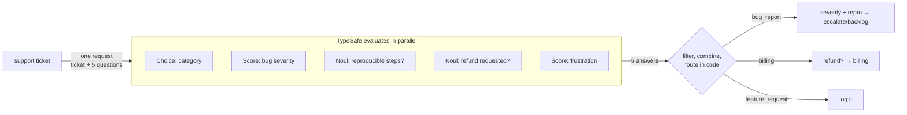
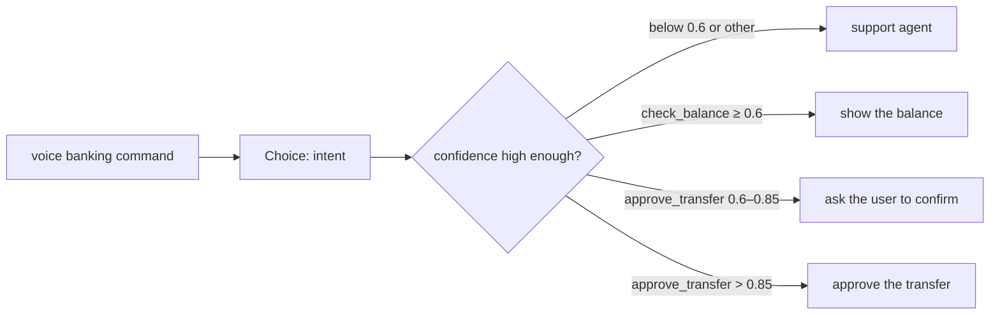
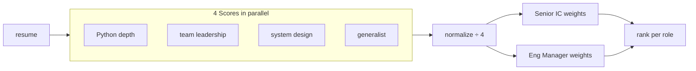
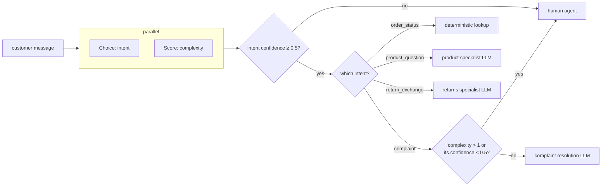

# 7. Patterns

[← Back to README](../README.md) · Source: <https://docs.typesafe.ai/patterns>

TypeSafe sits inside a larger system and powers its decisions. The key skill is thinking in **discrete, atomic decisions** that add up to complex system behavior.

| Pattern | What it does | Benefits |
|---|---|---|
| [Speculative fan-out](#speculative-fan-out) | Sends many questions in one call, including speculative ones, and lets code pick what's relevant | Cost, speed |
| [Confidence-gated routing](#confidence-gated-routing) | Uses confidence as a second decision axis | Reliability, safety |
| [Composite scoring](#composite-scoring) | Combines several dimensions into one score with weights in code | Cost, reliability, speed |
| [Intent routing](#intent-routing) | Classifies intent and routes to the best handler | Cost, speed |

---

## Speculative fan-out

Source: <https://docs.typesafe.ai/patterns/fan-out>

Put **every** question your system might need into one request, and decide in code which answers matter. Speculative questions cost almost nothing when they turn out to be irrelevant, and they save a round trip when they're not.



### Step 1: fan out

```json
{
  "state": "Hi, I placed an order (#98423) last Thursday and was charged twice. I also can't log in after the site update, and adding Apple Pay would be really helpful. This is getting frustrating.",
  "model": "jev-latest",
  "questions": {
    "category": {
      "type": "choice",
      "instructions": "Determine the broad category of this support ticket",
      "criteria": {
        "bug_report": "The user is reporting something that is broken or producing errors",
        "billing": "Charges, invoices, refunds, subscriptions",
        "feature_request": "The user is requesting new functionality",
        "account": "Login, permissions, profile, security"
      }
    },
    "bug_severity": {
      "type": "score",
      "instructions": "How severe is the reported issue",
      "criteria": [
        "Cosmetic; no impact to functionality",
        "Broken or degraded feature; workaround exists",
        "Blocking issue; no workaround exists"
      ]
    },
    "has_reproducible_steps": {
      "type": "noul",
      "instructions": "The user describes specific steps to reproduce the issue"
    },
    "refund_requested": {
      "type": "noul",
      "instructions": "The user is explicitly asking for a refund or credit"
    },
    "frustration": {
      "type": "score",
      "instructions": "How frustrated the user appears",
      "criteria": ["Calm, matter-of-fact", "Frustrated but civil", "Very angry"]
    }
  }
}
```

> `bug_severity` and `has_reproducible_steps` only matter for bug reports, and `refund_requested` only matters for billing. Ask them all up front anyway.

### Step 2: route with code

**Python**

```python
category = response.answers["category"]
bug_severity = response.answers["bug_severity"]
bug_repro = response.answers["has_reproducible_steps"]
refund = response.answers["refund_requested"]
frustration = response.answers["frustration"]

if category.choice == "bug_report":
    if bug_severity.score > 1.5 and bug_repro.noul > 0.6:
        escalate_to_engineering(ticket_id, severity="high")
    else:
        add_to_bug_backlog(ticket_id)

elif category.choice == "billing":
    if refund.noul > 0.7:
        route_to_billing_with_flag(ticket_id, refund_likely=True)
    else:
        route_to_billing(ticket_id)

elif category.choice == "feature_request":
    log_feature_request(ticket_id)

# Frustration is useful regardless of category
if frustration.score > 1.5:
    flag_for_priority_response(ticket_id)
```

**TypeScript**

<!-- ts-check run:
declare const ticket: string;
declare const ticketId: string;
declare function escalateToEngineering(id: string, severity: "high"): void;
declare function addToBugBacklog(id: string): void;
declare function routeToBillingWithFlag(id: string, o: { refundLikely: boolean }): void;
declare function routeToBilling(id: string): void;
declare function logFeatureRequest(id: string): void;
declare function flagForPriorityResponse(id: string): void;
-->
```ts
import { choice, noul, score, TypeSafeClient } from "@typesafe-ai/sdk";

const { answers } = await new TypeSafeClient().systemOne({
  state: ticket,
  questions: {
    category: choice("Determine the broad category of this support ticket", {
      bug_report: "The user is reporting something that is broken or producing errors",
      billing: "Charges, invoices, refunds, subscriptions",
      feature_request: "The user is requesting new functionality",
      account: "Login, permissions, profile, security",
    }),
    bug_severity: score("How severe is the reported issue", [
      "Cosmetic; no impact to functionality",
      "Broken or degraded feature; workaround exists",
      "Blocking issue; no workaround exists",
    ]),
    has_reproducible_steps: noul("The user describes specific steps to reproduce the issue"),
    refund_requested: noul("The user is explicitly asking for a refund or credit"),
    frustration: score("How frustrated the user appears", ["Calm, matter-of-fact", "Frustrated but civil", "Very angry"]),
  },
});

const { category, bug_severity, has_reproducible_steps, refund_requested, frustration } = answers;

if (category.choice === "bug_report") {
  if (bug_severity.score > 1.5 && has_reproducible_steps.noul > 0.6) escalateToEngineering(ticketId, "high");
  else addToBugBacklog(ticketId);
} else if (category.choice === "billing") {
  if (refund_requested.noul > 0.7) routeToBillingWithFlag(ticketId, { refundLikely: true });
  else routeToBilling(ticketId);
} else if (category.choice === "feature_request") {
  logFeatureRequest(ticketId);
}

// Frustration is useful regardless of category
if (frustration.score > 1.5) flagForPriorityResponse(ticketId);
```

### Anti-pattern: sequential calls

**Python**

```python
# ❌ Slower and more expensive: three round trips
cat = ask("What category of request is this?")
if cat == "smarthome_command":
    device = ask("What type of device is this request targeting?")
    if device == "lights":
        action = ask("What action should be taken on the lights?")

# ✅ One round trip: ask everything, including speculative questions
answers = client.system_one(state=req, questions={
    "category": ..., "domain": ..., "device": ..., "light_action": ..., "thermostat_action": ...,
}).answers
```

**TypeScript**

<!-- ts-check:
import { choice, TypeSafeClient } from "@typesafe-ai/sdk";
declare const client: TypeSafeClient;
declare const req: string;
declare function ask(q: string): Promise<string>;
const category = choice("What category of request is this?", { smarthome_command: null, conversation: null });
const domain = choice("What domain is this request targeting?", { whole_house: null, single_room: null });
const device = choice("What type of device is this request targeting?", { lights: null, thermostat: null });
const light_action = choice("What action should be taken on the lights?", { on: null, off: null });
const thermostat_action = choice("What should the thermostat do?", { warmer: null, cooler: null });
-->
```ts
// ❌ Slower and more expensive: three sequential round trips
const cat = await ask("What category of request is this?");
if (cat === "smarthome_command") {
  const device = await ask("What type of device is this request targeting?");
  if (device === "lights") {
    const action = await ask("What action should be taken on the lights?");
  }
}

// ✅ One round trip: ask everything, including speculative questions
const { answers } = await client.systemOne({
  state: req,
  questions: { category, domain, device, light_action, thermostat_action },
});
```

---

## Confidence-gated routing

Source: <https://docs.typesafe.ai/patterns/confidence-routing>

The **answer** tells you *what*. The **confidence** tells you *whether to act*. Example: a voice banking interface.



### Step 1: determine intent

```json
{
  "questions": {
    "intent": {
      "type": "choice",
      "instructions": "What action is the user requesting?",
      "criteria": {
        "check_balance": "Check the balance of an account",
        "approve_transfer": "Approve the pending transfer request",
        "other": "Something else"
      }
    }
  }
}
```

### Step 2: gate on confidence

**Python**

```python
action = response.answers["intent"]

# Below 0.6 confidence on any action, route to a human
if action.confidence < 0.6:
    route_to_support_agent(account_id)

elif action.choice == "check_balance":
    # Low stakes. 0.6 confidence is sufficient.
    show_balance(account_id)

elif action.choice == "approve_transfer":
    if action.confidence > 0.85:
        # High stakes, but high confidence. Safe to act automatically.
        approve_transfer(account_id)
    else:
        # High stakes, moderate confidence. Verify intent first.
        ask_user_to_confirm("Just to confirm: you would like to approve this transfer, is that correct?")

else:
    route_to_support_agent(account_id)
```

**TypeScript**

<!-- ts-check:
import { TypeSafeClient } from "@typesafe-ai/sdk";
declare const client: TypeSafeClient;
declare const command: string;
declare const accountId: string;
declare function routeToSupportAgent(a: string): void;
declare function showBalance(a: string): void;
declare function approveTransfer(a: string): void;
declare function askUserToConfirm(q: string): void;
-->
```ts
import { choice } from "@typesafe-ai/sdk";

const { answers } = await client.systemOne({
  state: command,
  questions: {
    intent: choice("What action is the user requesting?", {
      check_balance: "Check the balance of an account",
      approve_transfer: "Approve the pending transfer request",
      other: "Something else",
    }),
  },
});
const action = answers.intent;

// Below 0.6 confidence on any action, route to a human
if (action.confidence < 0.6) {
  routeToSupportAgent(accountId);
} else if (action.choice === "check_balance") {
  // Low stakes. 0.6 confidence is sufficient.
  showBalance(accountId);
} else if (action.choice === "approve_transfer") {
  if (action.confidence > 0.85) {
    // High stakes, but high confidence. Safe to act automatically.
    approveTransfer(accountId);
  } else {
    // High stakes, moderate confidence. Verify intent first.
    askUserToConfirm("Just to confirm: you would like to approve this transfer, is that correct?");
  }
} else {
  routeToSupportAgent(accountId);
}
```

---

## Composite scoring

Source: <https://docs.typesafe.ai/patterns/composite-scoring>

Break a complex judgment into independent dimensions, score each one, and combine them with weights **you** control. Example: screening resumes for two different roles.



### Step 1: score each dimension independently

```json
{
  "questions": {
    "python_depth": {
      "type": "score",
      "instructions": "How much depth of python experience does this candidate have, based on the supplied resume?",
      "criteria": [
        "No Python experience mentioned",
        "Mentioned but no detail",
        "Used in projects, some specifics",
        "Primary language, multiple projects",
        "Deep expertise: architecture, performance, libraries"
      ]
    },
    "team_leadership": {
      "type": "score",
      "instructions": "How much experience does this candidate have managing or leading engineering teams?",
      "criteria": [
        "No management experience mentioned",
        "Informal mentorship or tech lead role",
        "Led a small team or project",
        "Managed a team with direct reports",
        "Managed multiple teams or an engineering org"
      ]
    },
    "system_design": {
      "type": "score",
      "instructions": "How much experience does this candidate have designing large-scale or distributed systems?",
      "criteria": [
        "No architecture work mentioned",
        "Contributed to design discussions",
        "Designed components of a larger system",
        "Owned architecture of a significant system",
        "Designed systems at scale across multiple domains"
      ]
    },
    "generalist": {
      "type": "score",
      "instructions": "How much evidence is there that this candidate picks up unfamiliar tools, roles, or domains outside their core specialty?",
      "criteria": [
        "Only one domain or role mentioned",
        "Some variety but within a narrow field",
        "Worked across a few different areas or tech stacks",
        "Regularly moved between domains, wore many hats",
        "Track record of ramping up in unfamiliar areas and delivering"
      ]
    }
  }
}
```

### Step 2: combine with weights

**Python**

```python
py      = response.answers["python_depth"].score / 4
lead    = response.answers["team_leadership"].score / 4
arch    = response.answers["system_design"].score / 4
general = response.answers["generalist"].score / 4

# Senior IC
ic_score = (0.40 * py) + (0.10 * lead) + (0.40 * arch) + (0.10 * general)

# Engineering Manager
em_score = (0.15 * py) + (0.40 * lead) + (0.20 * arch) + (0.25 * general)
```

**TypeScript**

<!-- ts-check:
import type { ScoreResponse } from "@typesafe-ai/sdk";
declare const answers: Record<"python_depth" | "team_leadership" | "system_design" | "generalist", ScoreResponse>;
-->
```ts
const py = answers.python_depth.score / 4;
const lead = answers.team_leadership.score / 4;
const arch = answers.system_design.score / 4;
const general = answers.generalist.score / 4;

// Senior IC
const icScore = 0.4 * py + 0.1 * lead + 0.4 * arch + 0.1 * general;

// Engineering Manager
const emScore = 0.15 * py + 0.4 * lead + 0.2 * arch + 0.25 * general;
```

Rank candidates over a batch:

**Python**

```python
from concurrent.futures import ThreadPoolExecutor

def evaluate(resume: str) -> dict:
    a = client.system_one(state=resume, questions=RESUME_QUESTIONS).answers
    dims = {k: a[k].score / 4 for k in RESUME_QUESTIONS}
    return {
        "ic": 0.40 * dims["python_depth"] + 0.10 * dims["team_leadership"] + 0.40 * dims["system_design"] + 0.10 * dims["generalist"],
        "em": 0.15 * dims["python_depth"] + 0.40 * dims["team_leadership"] + 0.20 * dims["system_design"] + 0.25 * dims["generalist"],
        "dims": dims,  # keep the nuance for review
    }

with ThreadPoolExecutor(max_workers=8) as pool:
    results = list(pool.map(evaluate, resumes))

top_ic = sorted(zip(resumes, results), key=lambda r: -r[1]["ic"])[:10]
```

**TypeScript**

<!-- ts-check run:
const resumes: string[] = ["10 years of Python, led a team of 6.", "Data analyst, SQL and Excel."];
-->
```ts
import { score, TypeSafeClient } from "@typesafe-ai/sdk";

const RESUME_QUESTIONS = {
  python_depth: score("How much depth of python experience does this candidate have, based on the supplied resume?", [
    "No Python experience mentioned",
    "Mentioned but no detail",
    "Used in projects, some specifics",
    "Primary language, multiple projects",
    "Deep expertise: architecture, performance, libraries",
  ]),
  team_leadership: score("How much experience does this candidate have managing or leading engineering teams?", [
    "No management experience mentioned",
    "Informal mentorship or tech lead role",
    "Led a small team or project",
    "Managed a team with direct reports",
    "Managed multiple teams or an engineering org",
  ]),
  system_design: score("How much experience does this candidate have designing large-scale or distributed systems?", [
    "No architecture work mentioned",
    "Contributed to design discussions",
    "Designed components of a larger system",
    "Owned architecture of a significant system",
    "Designed systems at scale across multiple domains",
  ]),
  generalist: score("How much evidence is there that this candidate picks up unfamiliar tools, roles, or domains outside their core specialty?", [
    "Only one domain or role mentioned",
    "Some variety but within a narrow field",
    "Worked across a few different areas or tech stacks",
    "Regularly moved between domains, wore many hats",
    "Track record of ramping up in unfamiliar areas and delivering",
  ]),
};
type Dim = keyof typeof RESUME_QUESTIONS;

const client = new TypeSafeClient();

async function evaluate(resume: string) {
  const { answers } = await client.systemOne({ state: resume, questions: RESUME_QUESTIONS });
  const d = Object.fromEntries((Object.keys(RESUME_QUESTIONS) as Dim[]).map((k) => [k, answers[k].score / 4])) as Record<Dim, number>;
  return {
    ic: 0.4 * d.python_depth + 0.1 * d.team_leadership + 0.4 * d.system_design + 0.1 * d.generalist,
    em: 0.15 * d.python_depth + 0.4 * d.team_leadership + 0.2 * d.system_design + 0.25 * d.generalist,
    dims: d, // keep the nuance for review
  };
}

const results = await Promise.all(resumes.map(evaluate)); // requests run concurrently
const topIc = resumes
  .map((resume, i) => ({ resume, ...results[i] }))
  .sort((a, b) => b.ic - a.ic)
  .slice(0, 10);
```

> When the top candidates don't match your expectations, change the **weights**, not the prompts.

---

## Intent routing

Source: <https://docs.typesafe.ai/patterns/intent-routing>

Put TypeSafe in front of your handlers as a fast, cheap classifier. Some requests go to deterministic code, some to a specialist LLM, and some to a human.



### Step 1: classify intent and complexity

```json
{
  "questions": {
    "intent": {
      "type": "choice",
      "instructions": "The primary intent of this customer message",
      "criteria": {
        "order_status": "Asking about an existing order",
        "product_question": "Asking about a product before buying",
        "return_exchange": "Wants to return or exchange something",
        "complaint": "Unhappy with experience, wants resolution"
      }
    },
    "complexity": {
      "type": "score",
      "instructions": "How complex is this request to resolve",
      "criteria": [
        "Simple lookup or standard procedure",
        "Requires some judgment or multi-step process",
        "Unusual situation, edge case, or escalation needed"
      ]
    }
  }
}
```

### Step 2: route to the best handler

**Python**

```python
def route_ticket(ticket_id, response):
    intent = response.answers["intent"]
    complexity = response.answers["complexity"]

    if intent.confidence < 0.5:
        # If we don't have enough confidence to classify, route to a human agent
        return route_to_human_agent(ticket_id)

    if intent.choice == "order_status":
        handle_order_status(ticket_id)

    elif intent.choice == "product_question":
        handle_with_llm(ticket_id, PRODUCT_SPECIALIST)

    elif intent.choice == "return_exchange":
        handle_with_llm(ticket_id, RETURNS_SPECIALIST)

    elif intent.choice == "complaint":
        low_confidence = complexity.confidence < 0.5
        # A higher complexity.score leans toward the "escalation needed" end of the scale.
        if complexity.score > 1 or low_confidence:
            # Too complex for safe automation, or we're not sure about the complexity; route to a human.
            route_to_human_agent(ticket_id)
        else:
            handle_with_llm(ticket_id, COMPLAINT_RESOLUTION)
```

**TypeScript**

<!-- ts-check:
declare const PRODUCT_SPECIALIST: string, RETURNS_SPECIALIST: string, COMPLAINT_RESOLUTION: string;
declare function routeToHumanAgent(id: string): void;
declare function handleOrderStatus(id: string): void;
declare function handleWithLlm(id: string, prompt: string): void;
-->
```ts
import { choice, score, TypeSafeClient } from "@typesafe-ai/sdk";

const QUESTIONS = {
  intent: choice("The primary intent of this customer message", {
    order_status: "Asking about an existing order",
    product_question: "Asking about a product before buying",
    return_exchange: "Wants to return or exchange something",
    complaint: "Unhappy with experience, wants resolution",
  }),
  complexity: score("How complex is this request to resolve", [
    "Simple lookup or standard procedure",
    "Requires some judgment or multi-step process",
    "Unusual situation, edge case, or escalation needed",
  ]),
};

async function routeTicket(ticketId: string, message: string) {
  const { answers } = await new TypeSafeClient().systemOne({ state: message, questions: QUESTIONS });
  const { intent, complexity } = answers;

  // If we don't have enough confidence to classify, route to a human agent
  if (intent.confidence < 0.5) return routeToHumanAgent(ticketId);

  switch (intent.choice) {
    case "order_status":
      return handleOrderStatus(ticketId);
    case "product_question":
      return handleWithLlm(ticketId, PRODUCT_SPECIALIST);
    case "return_exchange":
      return handleWithLlm(ticketId, RETURNS_SPECIALIST);
    case "complaint": {
      // A higher complexity.score leans toward the "escalation needed" end of the scale.
      const lowConfidence = complexity.confidence < 0.5;
      // Too complex for safe automation, or we're not sure about the complexity: route to a human.
      if (complexity.score > 1 || lowConfidence) return routeToHumanAgent(ticketId);
      return handleWithLlm(ticketId, COMPLAINT_RESOLUTION);
    }
  }
}
```

The expensive resources (LLMs and people) only see the requests that actually need them.

---

[← 6. How to build](06-building-with-typesafe.md) · Next: [8. Cookbooks →](08-cookbooks.md)
